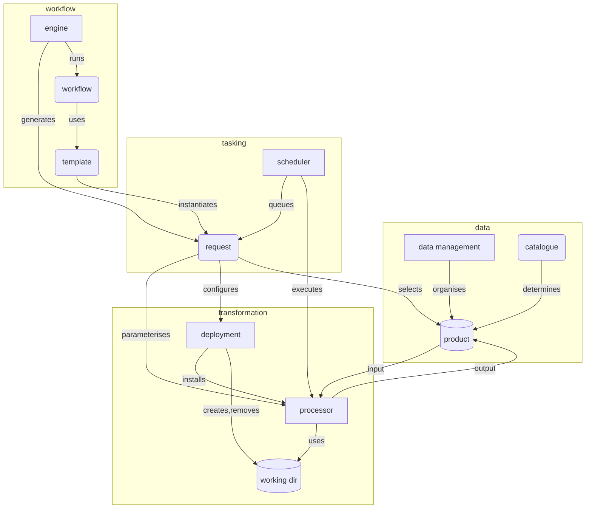

<!--
Copyright 2026 Brockmann Consult GmbH
-->

# Calvalus processing requests

This document describes the 2026 revision of Calvalus processing requests.
The 2026 revision aims at separating user parameters from technical parameters.

## Introduction

### Purpose and scope

Purpose of this document is to describe the parameters of processing requests, the structure and content of processor
descriptors, and to guide how to translate former requests into the revised structure. The new requests are a subset of
the old ones such that all old requests are valid new requests as well.

### Overview

A few concepts are helpful to describe Earth Observation data processing systems, in particular "product", "processor",
and "request".

- Earth observation data *products* are identifiable data items, often raster datasets, often part of a collection.
- The transformation of Earth Observation data products by a data *processor* into other products is called
  *processing*.
- A *processing system* is an entity that performs processing in a systematic way. This may be regularily, on demand, or
  in bulk.
- Generic processing systems can apply various processors to different types of products.
- Asynchronous generic processing systems use parameterised *requests* to separate tasking and transformation. Requests
  specify inputs, the transformation, and optionally more parameters for the execution. They are queued and executed by
  the processing system.

The following figure shows main concepts of processing systems and their relations.



This document focuses on requests.

### Document outline

After this introduction

- the reference part explains requests, processor desriptors, and all other sources of parameters
- the instruction part ...

## Reference part

### Requests and their parameters

A request is specified as a JSON text file and may look like the following:

```json
{
  "productionName": "C2RCC OLCI example request",
  "processor": "c2rcc-14.0/c2rcc-olci",
  "processorParameters": {
    "parameters": {
      "validPixelExpression": "!quality_flags.invalid && (!quality_flags.land || quality_flags.fresh_inland_water)"
    }
  },
  "inputPath": "/calvalus/eodata/OLCI_FR_L1/v2/2023/08/14/S3A_OL_1_EFR____20230814T224234_20230814T224534_20230816T035416_0179_102_158_1800_MAR_O_NT_002.SEN3.zip",
  "regionGeometry": "POLYGON((-180 60,-180 70,-170 70,-170 60,-180 60))",
  "outputDir": "/calvalus/home/cvop/test-c2rcc-olci"
}
```

The request specifies

- A name provided by the user. It will be displayed in queues.
- The processor, which is the combination of a processor package name and version and the processor (descriptor) name
- Optional processor parameters that override default values
- The input, in this case a single product item specified by its archive path. Details for input specification follow
  below
- Optional subset to be provided as output. regionGeometry in other cases will also be used to determine the inputs.
- The target directory in the distributed file system where the result can be picked up.

Note that in comparison to the previous version of requests

- A processor is specified instead of processorName, processorBundles, snap, calvalus, and optionally Java version
- Technical parameters like memory settings are removed from the request.

Other parameters can still be overridden in requests. But there are suitable defaults for most cases in the processor
descriptor (see next section).

### Processors and their descriptors

The processor descriptor for the request above lives in the processor package and is called c2rcc-olci-descriptor.json .
It specifies technical parameters, a descriptor that includes the authorisation who is allowed to use the processor, the
processor parameter list, and an optional output band list. The parts of this file are explained one by one. It is a single file.

```json
{
  "processorName": "c2rcc.olci",
  "processorType": "snap-operator",
  "productionType": "processing",
  "calvalus.system.s3tbx.reader.olci.pixelGeoCoding": "true",
  "calvalus.system.snap.pixelGeoCoding.useTiling": "true",
  "calvalus.system.snap.useAlternatePixelGeoCoding": "true",
  "calvalus.system.snap.pixelGeoCoding.fractionAccuracy": "true",
  "outputFormat": "NetCDF4",
  "queue": "default",
  "timeout": "1800",
  "attempts": "3",
  "failurePercent": "5",
  "processingMemory": "8192",
  "snap.tileCache": "4096",
  "processorJavaVersion": "21",
  "processorBundles": "c2rcc-14.0",
  "calvalus": "calvalus-3.1",
  "snap": "snap-14.0cv",
  ...
}
```

The technical parameters comprise

- the processor name, processor bundles, snap, calvalus, and processor java version if different from "8"
- the production type. Note that there shall be different descriptors for processing, l3-agg, ma, and ra if all of them
  are to be used.
- suitable values for timeout and memory settings
- defaults for output format, queue, attempts, failure percentage that users may override in requests

Note that in comparison to the previous version of requests a descriptor is required. It translates "processor" into
software packages and the processor name and proper defaults, and it specifies authorisation.

```json
{
  ...
  "processorDescriptor": {
    "title": "Case 2R/CoastColour processor for OLCI",
    "version": "14.0",
    "description": "Performs atmospheric correction and IOP retrieval on Sentinel-2 MSI products using a neural-network approach",
    "authorisation": [
      "group:bc"
    ],
    "inputProductTypes": [
      "OLCI_L1B",
      "OL_1_EFR",
      "OL_1_ERR"
    ],
    "outputProductType": "S3_OLCI_L2",
    "outputFormats": [
      "NetCDF4",
      "NetCDF",
      "GeoTIFF",
      "BEAM-DIMAP"
    ],
    ...
  }
}
```

The essential specification in the processorDescriptor section is authorisation with a list of groups or users that are
allowed to use the processor. This is used by Calvalus to check whether the user is allowed to submit a request for this
processor. All other parameters are for presentation in user interfaces.

```json
{
  ...,
  "processorDescriptor": {
    ...
    "parameterDescriptor": {
      "validPixelExpression": {
        "title": "Defines the pixels which are valid for processing, SNAP syntax",
        "type": "string",
        "default": "!quality_flags.invalid && (!quality_flags.land || quality_flags.fresh_inland_water)",
        "path": "aggregationParameters/parameters"
      },
      "salinity": {
        "title": "Value used as salinity for the scene, unit [PSU]",
        "type": "float",
        "default": "35.0",
        "path": "aggregationParameters/parameters"
      },
      "temperature": {
        "title": "Value used as temperature for the scene, unit [C]",
        "type": "float",
        "default": "15.0",
        "path": "aggregationParameters/parameters"
      },
      "ozone": {
        "title": "Value used as ozone if not provided by auxiliary data",
        "type": "float",
        "default": "330.0",
        "path": "aggregationParameters/parameters"
      },
      "press": {
        "title": "Value used as surface air pressure at sea level if not provided by auxiliary data",
        "type": "float",
        "default": "1000.0",
        "path": "aggregationParameters/parameters"
      },
      "outputAsRrs": {
        "title": "Output AC reflectances as rrs instead of rhow",
        "type": "boolean",
        "default": "false"
      },
      "deriveRwFromPathAndTransmittance": {
        "title": "Derive water reflectance from path radiance and transmittance",
        "type": "boolean",
        "default": "false",
        "path": "aggregationParameters/parameters"
      },
      "useEcmwfAuxData": {
        "title": "Use ECMWF aux data embedded into source product",
        "type": "boolean",
        "default": "true",
        "path": "aggregationParameters/parameters"
      },
      "demName": {
        "title": "Name of digital elevation model",
        "type": "enum",
        "values": [
          "",
          "Copernicus 90m Global DEM",
          "Copernicus 30m Global DEM",
          "GETASSE30"
        ],
        "default": "true",
        "path": "aggregationParameters/parameters"
      },
      "outputUncertainties": {
        "title": "Output uncertainties",
        "type": "boolean",
        "default": "true",
        "path": "aggregationParameters/parameters"
      },
      "outputFormat": {
        "title": "Output file format, default NetCDF4",
        "type": "string"
      },
      "queue": {
        "title": "Processing queue, default 'default'",
        "type": "string"
      },
      "attempts": {
        "title": "Number of attempts, 1-4, default 3",
        "type": "int"
      },
      "failurePercentage": {
        "title": "Percentage of failed inputs before abort, default 5",
        "type": "int"
      }
    },
    ...
  }
}
```

The list of parameters is part of the descriptor. It is required to show selections in user interfaces. It is optional
for processors used internally with a limited set of requests or templates.

```json
{
  ...
  "processorDescriptor": {
    ...
    "outputBandDescriptor": {
      "rhow_1": {
        "title": "Atmospherically corrected angular dependent water leaving reflectances at 400.0 nm",
        "type": "float"
      },
      "rhow_2": {
        "title": "Atmospherically corrected angular dependent water leaving reflectances at 412.5 nm",
        "type": "float"
      },
      "rhow_3": {
        "title": "Atmospherically corrected angular dependent water leaving reflectances at 442.5 nm",
        "type": "float"
      },
      "rhow_4": {
        "title": "Atmospherically corrected angular dependent water leaving reflectances at 490.0 nm",
        "type": "float"
      },
      "rhow_5": {
        "title": "Atmospherically corrected angular dependent water leaving reflectances at 510.0 nm",
        "type": "float"
      },
      "rhow_6": {
        "title": "Atmospherically corrected angular dependent water leaving reflectances at 560.0 nm",
        "type": "float"
      },
      "rhow_7": {
        "title": "Atmospherically corrected angular dependent water leaving reflectances at 620.0 nm",
        "type": "float"
      },
      "rhow_8": {
        "title": "Atmospherically corrected angular dependent water leaving reflectances at 665.0 nm",
        "type": "float"
      },
      "rhow_9": {
        "title": "Atmospherically corrected angular dependent water leaving reflectances at 673.75 nm",
        "type": "float"
      },
      "rhow_10": {
        "title": "Atmospherically corrected angular dependent water leaving reflectances at 681.25 nm",
        "type": "float"
      },
      "rhow_11": {
        "title": "Atmospherically corrected angular dependent water leaving reflectances at 708.75 nm",
        "type": "float"
      },
      "rhow_12": {
        "title": "Atmospherically corrected angular dependent water leaving reflectances at 753.75 nm",
        "type": "float"
      },
      "rhow_16": {
        "title": "Atmospherically corrected angular dependent water leaving reflectances at 778.75 nm",
        "type": "float"
      },
      "rhow_17": {
        "title": "Atmospherically corrected angular dependent water leaving reflectances at 865.0 nm",
        "type": "float"
      },
      "rhow_18": {
        "title": "Atmospherically corrected angular dependent water leaving reflectances at 885.0 nm",
        "type": "float"
      },
      "rhow_21": {
        "title": "Atmospherically corrected angular dependent water leaving reflectances at 1020.0 nm",
        "type": "float"
      },
      "iop_apig": {
        "title": "Absorption coefficient of phytoplankton pigments at 443 nm",
        "type": "float"
      },
      "iop_adet": {
        "title": "Absorption coefficient of detritus at 443 nm",
        "type": "float"
      },
      "iop_agelb": {
        "title": "Absorption coefficient of gelbstoff at 443 nm",
        "type": "float"
      },
      "iop_bpart": {
        "title": "Scattering coefficient of marine paticles at 443 nm",
        "type": "float"
      },
      "iop_bwit": {
        "title": "Scattering coefficient of white particles at 443 nm",
        "type": "float"
      },
      "iop_adg": {
        "title": "Detritus + gelbstoff absorption at 443 nm",
        "type": "float"
      },
      "iop_atot": {
        "title": "phytoplankton + detritus + gelbstoff absorption at 443 nm",
        "type": "float"
      },
      "iop_btot": {
        "title": "total particle scattering at 443 nm",
        "type": "float"
      },
      "kd489": {
        "title": "Irradiance attenuation coefficient at 489 nm",
        "type": "float"
      },
      "kdmin": {
        "title": "Mean irradiance attenuation coefficient at the three bands with minimum kd",
        "type": "float"
      },
      "kd_z90max": {
        "title": "Depth of the water column from which 90% of the water leaving irradiance comes from",
        "type": "float"
      },
      "conc_tsm": {
        "title": "Total suspended matter dry weight concentration",
        "type": "float"
      },
      "conc_chl": {
        "title": "Chlorophyll concentration",
        "type": "float"
      },
      "c2rcc_flags": {
        "title": "C2RCC quality flags",
        "type": "uint"
      },
      "quality_flags": {
        "title": "Classification and quality flags",
        "type": "uint"
      }
    }
  }
}
```

The list of output bands help to write aggregation parameters or regional statistics parameters, e.g. in case users want
to override a default in a request. It is not required for processors used by a limited number of requests or templates.

A processor descriptor for the corresponding l3-agg production type is called c2rcc-olci-agg-descriptor.json and looks
like the following:

```text
{
    "processorName"    : "c2rcc.olci",
    "processorType"    : "snap-operator",
    "productionType"   : "l3-agg",
    
    "calvalus.system.s3tbx.reader.olci.pixelGeoCoding" : "true",
    "calvalus.system.snap.pixelGeoCoding.useTiling" : "true",
    "calvalus.system.snap.useAlternatePixelGeoCoding" : "true",
    "calvalus.system.snap.pixelGeoCoding.fractionAccuracy" : "true",

    "inputSubsetting"  : "false",
    "outputSubsetting" : "true",

    "aggregationParameters" : {
        "parameters" : {
            "planetaryGrid" : "EPSG:4326",
            "numRows" : "64800",
            "compositingType" : "MOSAICKING",
            "superSampling" : "1",
            "maskExpr" : "quality_flags == 1",
            "aggregators" : {
                "aggregator" : [
                    { "type": "MEAN", "varName": "rhow_1" },
                    { "type": "MEAN", "varName": "rhow_1" },
                    { "type": "MEAN", "varName": "rhow_2" },
                    { "type": "MEAN", "varName": "rhow_3" },
                    { "type": "MEAN", "varName": "rhow_4" },
                    { "type": "MEAN", "varName": "rhow_5" },
                    { "type": "MEAN", "varName": "rhow_6" },
                    { "type": "MEAN", "varName": "rhow_7" },
                    { "type": "MEAN", "varName": "rhow_8" },
                    { "type": "MEAN", "varName": "rhow_9" },
                    { "type": "MEAN", "varName": "rhow_10" },
                    { "type": "MEAN", "varName": "rhow_11" },
                    { "type": "MEAN", "varName": "rhow_12" },
                    { "type": "MEAN", "varName": "rhow_16" },
                    { "type": "MEAN", "varName": "rhow_17" },
                    { "type": "MEAN", "varName": "rhow_18" },
                    { "type": "MEAN", "varName": "rhow_21" },
                    { "type": "MEAN", "varName": "iop_apig" },
                    { "type": "MEAN", "varName": "iop_adet" },
                    { "type": "MEAN", "varName": "iop_agelb" },
                    { "type": "MEAN", "varName": "iop_bpart" },
                    { "type": "MEAN", "varName": "iop_bwit" },
                    { "type": "MEAN", "varName": "iop_adg" },
                    { "type": "MEAN", "varName": "iop_atot" },
                    { "type": "MEAN", "varName": "iop_btot" },
                    { "type": "MEAN", "varName": "kd489" },
                    { "type": "MEAN", "varName": "kdmin" },
                    { "type": "MEAN", "varName": "kd_z90max" },
                    { "type": "MEAN", "varName": "conc_tsm" },
                    { "type": "MEAN", "varName": "conc_chl" },
                    { "type": "FIRST", "varName": "c2rcc_flags" },
                    { "type": "FIRST", "varName": "quality_flags" }
                ]
            }
        }
    },

    "outputFormat"     : "NetCDF4",
    "maxReducers"      : "1",
    
    "queue"            : "default",
    "timeout"          : "1800",
    "attempts"         : "3",
    "failurePercent"   : "5",
    "processingMemory" : "8192",
    "aggregationMemory": "4092",
    "snap.tileCache"   : "4096",

    "processorJavaVersion" : "21",
    "processorBundles" : "c2rcc-14.0",
    "calvalus"         : "calvalus-3.1",
    "snap"             : "snap-14.0cv",

    "processorDescriptor": {
        "title": "Case 2R/CoastColour processor for OLCI",
        "version": "14.0",
        "description": "Performs atmospheric correction and IOP retrieval on Sentinel-2 MSI products using a neural-network approach",
        "authorisation": [ "group:bc" ],
        "inputProductTypes": [ "OLCI_L1B", "OL_1_EFR", "OL_1_ERR" ],
        "outputProductType": "S3_OLCI_L2",
        "outputFormats": [ "NetCDF4", "NetCDF", "GeoTIFF", "BEAM-DIMAP" ],
        "parameterDescriptor": {
            "validPixelExpression": {
                "title": "Defines the pixels which are valid for processing, SNAP syntax",
                "type": "string",
                "default": "!quality_flags.invalid && (!quality_flags.land || quality_flags.fresh_inland_water)",
                "path": "processorParameters/parameters"
            },
            "salinity": {
                "title": "Value used as salinity for the scene, unit [PSU]",
                "type": "float",
                "default": "35.0",
                "path": "processorParameters/parameters"
            },
            "temperature": {
                "title": "Value used as temperature for the scene, unit [C]",
                "type": "float",
                "default": "15.0",
                "path": "processorParameters/parameters"
            },
            "ozone": {
                "title": "Value used as ozone if not provided by auxiliary data",
                "type": "float",
                "default": "330.0",
                "path": "processorParameters/parameters"
            },
            "press": {
                "title": "Value used as surface air pressure at sea level if not provided by auxiliary data",
                "type": "float",
                "default": "1000.0",
                "path": "processorParameters/parameters"
            },
            "outputAsRrs": {
                "title": "Output AC reflectances as rrs instead of rhow",
                "type": "boolean",
                "default": "false",
                "path": "processorParameters/parameters"
            },
            "deriveRwFromPathAndTransmittance": {
                "title": "Derive water reflectance from path radiance and transmittance",
                "type": "boolean",
                "default": "false",
                "path": "processorParameters/parameters"
            },
            "useEcmwfAuxData": {
                "title": "Use ECMWF aux data embedded into source product",
                "type": "boolean",
                "default": "true",
                "path": "processorParameters/parameters"
            },
            "demName": {
                "title": "Name of digital elevation model",
                "type": "enum",
                "values": [ "", "Copernicus 90m Global DEM", "Copernicus 30m Global DEM", "GETASSE30" ],
                "default": "true",
                "path": "processorParameters/parameters"
            },
            "outputUncertainties": {
                "title": "Output uncertainties",
                "type": "boolean",
                "default": "true",
                "path": "processorParameters/parameters"
            },
            
            "planetaryGrid": {
                "title": "Target grid EPSG",
                "type": "string",
                "default": "EPSG:4326",
                "path": "aggregationParameters/parameters"
            },
            "numRows": {
                "title": "Target grid resolution as numbers of rows from pole to pole",
                "type": "int",
                "default": "64800",
                "path": "aggregationParameters/parameters"
            },
            "compositingType": {
                "title": "Aggregation method, BINNING or MOSAICKING",
                "type": "string",
                "default": "MOSAICKING",
                "path": "aggregationParameters/parameters"
            },
            "superSampling": {
                "title": "Supersampling factor for BINNING",
                "type": "int",
                "default": "1",
                "path": "aggregationParameters/parameters"
            },
            "maskExpr": {
                "title": "Valid mask for aggregation",
                "type": "string",
                "default": "quality_flags == 1",
                "path": "aggregationParameters/parameters"
            },
            "variables": {
                "title": "Variables structure",
                "type": "object",
                "path": "aggregationParameters/parameters"
            },
            "aggregators": {
                "title": "Aggregators structure",
                "type": "object",
                "path": "aggregationParameters/parameters"
            },
            
            "outputFormat": {
                "title": "Output file format, default NetCDF4",
                "type": "string"
            },
            "outputPattern": {
                "title": "Output pattern, usually L3_(....-..-..)_(....-..-..), optional",
                "type": "string"
            },
            "outputReplacement": {
                "title": "Output replacement, e.g. OLCI-C2RCC-L3-\\1-P1D, optional",
                "type": "string"
            },
            "queue": {
                "title": "Processing queue, default 'default'",
                "type": "string"
            },
            "attempts": {
                "title": "Number of attempts, 1-4, default 3",
                "type": "int"
            },
            "failurePercentage": {
                "title": "Percentage of failed inputs before abort, default 5",
                "type": "int"
            }
        }
    }
}
```

There are defaults for the aggregationParameter structure that can be partially overridden in a request.
Note that the parameter specification contains the path for those parameters that map into structures, either
processingParameters or aggregationParameters. The parameters section is not relevant for processors used with a limited
number of requests and templates.

### Example request

Each processor shall have a simple, executable example request. It may be the request the processor is initially tested
after installation. The example request for the descriptor of the previous subsection is named
c2rcc-olci-example-request.json, is stored in the processor package, and contains what is listed in the beginning of the
previous section (see above).

Another example is the example request for the respective aggregation case, c2rcc-olci-agg-example-request.json :

```json
{
  "productionName": "C2RCC OLCI aggregation example request",
  "processor": "c2rcc-14.0/c2rcc-olci-agg",
  "processorParameters": {
    "parameters": {
      "validPixelExpression": "!quality_flags.invalid && (!quality_flags.land || quality_flags.fresh_inland_water)"
    }
  },
  "aggregationParameters": {
    "parameters": {
      "planetaryGrid": "EPSG:4326",
      "numRows": "64800",
      "compositingType": "MOSAICKING"
    }
  },
  "dateRanges": [
    "2026-06-01",
    "2026-06-02"
  ],
  "regionGeometry": "POLYGON((-180 60,-180 70,-170 70,-170 60,-180 60))",
  "inputInventory": "/calvalus/geoInventory/OLCI_FR_L1_v2",
  "outputDir": "test-c2rcc-olci-agg"
}
```

It can overrides selected attributes of processorParameters and of aggregationParameters. The example uses a different
way to specify the input (see next section).

### Input specification

Inputs can be specified by

- archive paths or path patterns, optionally with date ranges
- geo-inventory and spatio-temporal selection, i.e. polygon and date ranges
- product identifiers in some remote file system
- catalogue query and archive path rule

For a specific input, inputPath with a path into the distributed file system archive can be used.

```text
    "inputPath" : "/calvalus/eodata/OLCI_FR_L1/v2/2023/08/14/S3A_OL_1_EFR____20230814T224234_20230814T224534_20230816T035416_0179_102_158_1800_MAR_O_NT_002.SEN3.zip",
```

inputPath can be combined with a file name pattern and with dateRanges

```text
    "inputPath"  : "/calvalus/eodata/S2_L1C/v5/${yyyy}/${MM}/${dd}/S2._MSIL1C_.*_T32UMA_.*.zip",
    "dateRanges" : [ "2026-06-01:2026-06-03" ],
```

The path pattern can contain alternatives.

```text
    "inputPath"  : "/calvalus/eodata/S2_L1C/v5/${yyyy}/${MM}/${dd}/S2._MSIL1C_.*_T32(:?UMA|UMB)_.*.zip",
    "dateRanges" : [ "2026-06-01:2026-06-03" ],
```

If available for the product collection an input inventory can be used in combination with date range and region.

```text
    "inputInventory" : "/calvalus/geoInventory/OLCI_FR_L1_v2",
    "dateRanges"     : [ "2026-06-01:2026-06-02" ],
    "regionGeometry"  : "POLYGON((-180 60,-180 70,-170 70,-170 60,-180 60))",
```

If the client does not have access to the archive but the archive path is known then the paths can be specified as one
or several remote paths.

```text
    "productIdentifiers" : "s3a://hroc/calvalus/projects/hroc/zone-l2-v1.11/7bls-35T/20200524-A-107/MSIL1C-60m-7bls-35T-A-107-20200524-v1.8-hroc-l2.nc,s3a://hroc/calvalus/projects/hroc/zone-l2-v1.11/7bls-36T/20200524-A-107/MSIL1C-60m-7bls-36T-A-107-20200524-v1.8-hroc-l2.nc",
```

If there is a catalogue then a parameterised catalogue query can determine the inputs. Date range and polygon can be
used in the query.

```text
    "inputInventory"   : "catalogue=creodias&collection=Sentinel2&dataset=ESA-DATASET&level=LEVEL1C",
    "calvalus.creodias.searchurl": "https://datahub.creodias.eu/odata/v1/Products?$filter=Attributes/OData.CSC.StringAttribute/any(att:att/Name eq 'productType' and att/OData.CSC.StringAttribute/Value eq 'S2MSI1C') and ContentDate/Start ge ${start}T00:00:00.000Z and ContentDate/Start le ${stop}T23:59:59.999Z and OData.CSC.Intersects(area=geography'SRID=4326;${polygon}')&$orderby=ContentDate/Start asc&$skip=${offset}&$top=${count}",
    "dateRanges"       : "[2025-07-01:2025-07-02]",
    "regionGeometry"   : "POLYGON((9.349753132315687 54.93517914414913,10.133902302237562 54.93517914414913,10.133902302237562 54.73190495438533,9.349753132315687 54.73190495438533,9.349753132315687 54.93517914414913))",
    "regionName"       : "Flensburg",
```

```text
    "inputInventory"   : "catalogue=creodias&collection=Sentinel2&dataset=ESA-DATASET&level=LEVEL2A",
    "calvalus.creodias.searchurl": "https://datahub.creodias.eu/odata/v1/Products?$filter=Attributes/OData.CSC.StringAttribute/any(att:att/Name eq 'productType' and att/OData.CSC.StringAttribute/Value eq 'S2MSI2A') and ContentDate/Start ge ${start}T00:00:00.000Z and ContentDate/Start le ${stop}T23:59:59.999Z and contains(Name,'51PUR')&$orderby=ContentDate/Start asc&$skip=${offset}&$top=${count}",
    "calvalus.creodias.pathpattern" : "(S2._MSIL2A_(....)(..)(..)(T......).*.SAFE)",
    "calvalus.creodias.pathreplacement": "s3a://eodata/Sentinel-2/MSI/L2A_N0500/$2/$3/$4/$1",
    "calvalus.creodias.acquisitiondatereplacement": "$2$3$4$5",
    "calvalus.n05xx.switchdate": "20230826T081331",
    "dateRanges"           : "[2023-08-22:2023-08-31]",
```    

### Quicklook generation

The processing production type and the l3-agg production type have an option to generate quicklooks for each output
product while the product is still in memory. The first example shows parameters for an RGB with a shapefile as overlay.

```text
    "qlParameters" : {
        "parameters" : {
            "quicklooks" : {
                "config" : {
                    "RGBAExpressions" : "B4,B3,B2,",
                    "RGBAMinSamples" : "0.0,0.0,0.0",
                    "RGBAMaxSamples" : "0.21,0.21,0.21",
                    "subSamplingX" : "5",
                    "subSamplingY" : "5",
                    "imageType" : "png",
                    "shapefileURL" : "file:///mnt/auxiliary/hroc/country_tiles_orbits_lines_20190611_sub.zip"
                }
            }
        }
    },
```

The second example shows parameters for a single band pseudo-colour image with a cpd legend.

```text
    "qlParameters" : {
        "parameters" : {
            "quicklooks" : {
                "config" : {
                    "bandName" : "CHL",
                    "cpdURL" : "file:///mnt/auxiliary/hroc/cpd/chl_DeM2_100.cpd",
                    "subSamplingX" : "5",
                    "subSamplingY" : "5",
                    "imageType" : "png",
                }
            }
        }
    },
```

### Metadata generation

A metadata file can be produced for each output by providing a template.

*to be described*

### Parameter translation and request submission

A request that a user submits is translated into a Hadoop job, one-to-one. Each job may lead to a large number of
concurrent tasks, depending on the inputs specified. But first, it will be one job. There are in fact four sets of
parameters in a request.

- parameters interpreted by the client that submits the request, e.g. the target address of the Hadoop system to send
  the request to
- parameters interpreted by Hadoop, e.g. memory setting or software packages to be available at runtime
- parameters interpreted by Calvalus, e.g. which production type to run
- parameters passed to the processor or aggregator, e.g. the processingParameter structure

In particular the Hadoop parameters have names that are different from the names specified in the request. They are
translated on the client side before submission to Hadoop.

The process of request translation involves

- the user request and its parameters
- processor descriptor parameters that are merged with them
- (If there is no new processor descriptor, then the old bundle descriptor is read for backwards compatibility.)
- production type parameters (e.g. etc/calvalus-processing-cht-type.json)
- calvalus configuration parameters
- parameter translation rules (etc/calvalus-cht-type.json)
- Hadoop defaults

If the cht command line tool is used then the translation happens in this client. It reads the request, determines the
processor package and descriptor name, reads the processor descriptor from the distributed file system, reads the
production type and the translation rules from the local etc/ directory, finds the calvalus configuration either in its
default location ~/calvalus/calvalus.config or specified with the environment variable CALVALUS_CONFIG set in the my...
file.

If the calvalus REST client is used (calvalus request submit <path>) then the translation happens in the calvalus proxy
(hosted by Tomcat on master00). The rest client sends the request to the proxy. There is one proxy address per Calvalus
target system, e.g. bc-calvalus or hroc-calvalus. The proxy determines the processor package and descriptor
name, looks up the descriptor in its cache, falls back to the distributed file system if not found in cache, reads the
production type, translation rules, and calvalus configuration for the target system from its local content directory.

The layout of the configuration and cache of the proxy looks like this:

```text
webapp
├── bc-calvalus
├── hroc-calvalus
content
├── bc-calvalus
│   ├── calvalus.properties
│   ├── c2rcc-13.0.rc1
│   │   ├── c2rcc-olci-descriptor.json
│   │   ├── c2rcc-olci-example-request.json
│   │   ├── c2rcc-olci-ra-example-request.json
│   │   └── c2rcc-olci-request-schema.json
│   ├── c2rcc-14.0
│   │   ├── c2rcc-olci-agg-descriptor.json
│   │   ├── c2rcc-olci-agg-example-request.json
│   │   ├── c2rcc-olci-descriptor.json
│   │   └── c2rcc-olci-example-request.json
│   ├── okosat-olci-1.1
│   │   ├── okosat-olci-descriptor.json
│   │   ├── okosat-olci-example-request.json
│   │   └── okosat-olci-l3-example-request.json
│   └── sen2water-0.6.4
│       ├── msiresampling-descriptor.json
│       ├── msiresampling-example-request.json
│       ├── sen2water-descriptor.json
│       └── sen2water-example-request.json
├── hroc-calvalus
│   ├── calvalus.properties
│   └── hroc-l123-1.9
│       ├── l4m-aggreg-descriptor.json
│       ├── l4m-aggreg-example-request.json
│       ├── l4m-format-descriptor.json
│       └── l4m-format-example-request.json
├── production-types
│   ├── calvalus-cht-type.json
│   ├── combinations-cht-type.json
│   ├── compositing-cht-type.json
│   ├── geodb-scan-cht-type.json
│   ├── geodb-update-cht-type.json
│   ├── l2-form-cht-type.json
│   ├── l2-proc-cht-type.json
│   ├── l3-agg-cht-type.json
│   ├── l3-form-cht-type.json
│   ├── lcl3-form-cht-type.json
│   ├── lcl3-sr-cht-type.json
│   ├── ma-cht-type.json
│   ├── processing-cht-type.json
│   ├── ql-gen-cht-type.json
│   └── ra-cht-type.json
└── schemas
    ├── c2rcc-13.0.rc1
    │   └── c2rcc-olci-request-schema.json
    ├── processing-request-schema.json
    ├── S3_OL_1_EFR-ra-example-request.json
    ├── S3_OL_1_EFR-request-schema.json
    └── schemas -> .
```

bc-calvalus/calvalus.properties contains the configuration for HDFS, resource manager, and history server:

```text
calvalus.hadoop.fs.defaultFS = hdfs://calvalus
calvalus.hadoop.dfs.nameservices = calvalus
calvalus.hadoop.dfs.ha.namenodes.calvalus = nn1,nn2
calvalus.hadoop.dfs.namenode.rpc-address.calvalus.nn1 = master00:8020
calvalus.hadoop.dfs.namenode.rpc-address.calvalus.nn2 = master01:8020
calvalus.hadoop.dfs.client.failover.proxy.provider.calvalus = org.apache.hadoop.hdfs.server.namenode.ha.ConfiguredFailoverProxyProvider

calvalus.hadoop.yarn.resourcemanager.ha.enabled = true
calvalus.hadoop.yarn.resourcemanager.cluster-id = calvalus-yarn
calvalus.hadoop.yarn.resourcemanager.ha.rm-ids = rm1,rm2
calvalus.hadoop.yarn.resourcemanager.hostname = master00
calvalus.hadoop.yarn.resourcemanager.hostname.rm1 = master00
calvalus.hadoop.yarn.resourcemanager.hostname.rm2 = master01
calvalus.hadoop.yarn.client.failover-proxy-provider = org.apache.hadoop.yarn.client.ConfiguredRMFailoverProxyProvider

calvalus.acl = true
calvalus.hadoop.mapreduce.jobhistory.address = master00:10200
calvalus.hadoop.mapreduce.jobhistory.webapp.address = master00:19888
calvalus.hadoop.yarn.log.server.url = master00:19888/jobhistory/logs
calvalus.hadoop.yarn.nodemanager.aux-services = mapreduce_shuffle
calvalus.hadoop.hadoop.proxyuser.hdfs.hosts = *
calvalus.hadoop.hadoop.proxyuser.hdfs.groups = *
calvalus.hadoop.dfs.user.home.dir.prefix = /calvalus/home
```

hroc-calvalus/calvalus-properties contains the configuration for the resource manager, the S3 bucket configuration (not
listed here), and default catalogue query paramters for MSI L1C input determination.

```text
fs.defaultFS = s3a://hroc
yarn.resourcemanager.hostname = hrocmaster
yarn.resourcemanager.address = hrocmaster:8032
mapreduce.jobhistory.address = hrocmaster:10020
mapreduce.jobhistory.webapp.address = hrocmaster:19888
yarn.log.server.url = hrocmaster:19888/jobhistory/logs
yarn.nodemanager.aux-services = mapreduce_shuffle
hadoop.proxyuser.hdfs.hosts = *
hadoop.proxyuser.hdfs.groups = *

hadoop.tmp.dir = /tmp/hadoop-yarn
dfs.user.home.dir.prefix = /calvalus/home
mapreduce.jvm.add-opens-as-default = false

...

calvalus.creodias.searchurl = https://datahub.creodias.eu/odata/v1/Products?$filter=Attributes/OData.CSC.StringAttribute/any(att:att/Name eq 'productType' and att/OData.CSC.StringAttribute/Value eq 'S2MSI1C') and ContentDate/Start ge ${start}T00:00:00.000Z and ContentDate/Start le ${stop}T23:59:59.999Z and OData.CSC.Intersects(area=geography'SRID=4326;${polygon}')&$orderby=ContentDate/Start asc&$skip=${offset}&$top=${count}
calvalus.creodias.searchjpath = value[*].Name
calvalus.creodias.pathpattern = (S2._MSIL1C_(....)(..)(..).*.SAFE)
calvalus.creodias.pathreplacement = s3a://eodata/Sentinel-2/MSI/L1C/$2/$3/$4/$1
```


### Instruction part

## How to convert existing requests and processors

## How to install a new processor

## How to upgrade an existing processor

